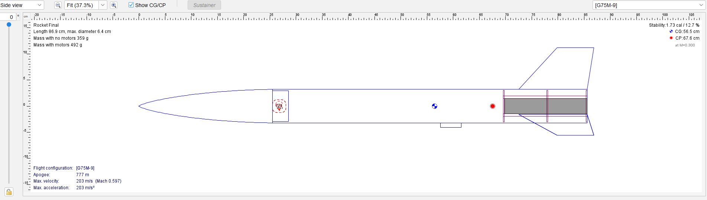
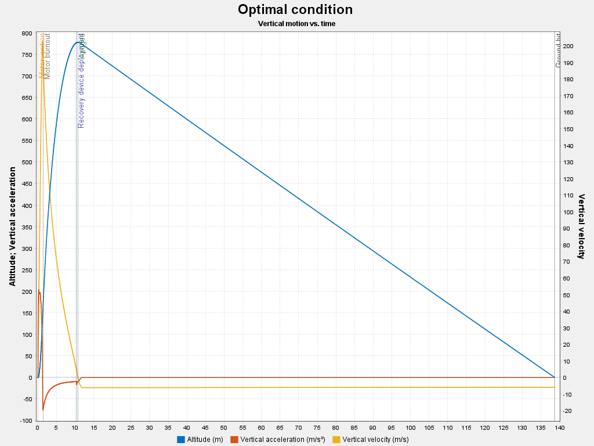

# Model Rocket Design and Stability Study (OpenRocket)

Design and simulation of a 0.87 m, 64 mm-diameter model rocket for an
AeroTech G75M motor OpenRocket 24.12. 
The study compares design variants (fin height, nose ballast, parachute size) one variable at a time,
checks stability, rail-exit speed and recovery and tests the effect of wind.

## Objective
Select a stable configuration and justify the choice with simulation data,
before any launch.

## Constraints
The motor (AeroTech G75M) and the fin material and geometry were fixed by the
project. Tthe study just varied fin height, nose ballast and parachute size.

## Background
- The centre of gravity (CG) must be ahead of the centre of
  pressure (CP) so that the rocket weathercocks back into the flow.
- Static margin = (CP - CG) / body diameter, in calibres (cal). Target 1-2 cal.
- Rail-exit speed must be high enough for the fins to be effective. Target
  about 15 m/s or more.
- Descent speed target about 4-6 m/s.

## Final design (Rocket Final)
| Item | Value |
|---|---|
| Length (nose + body tube) | 856 mm (868.9 mm including fin overhang) |
| Body diameter | 64 mm |
| Nose cone | Haack, 256 mm, polystyrene, with 30 mm shoulder |
| Body tube | Cardboard, 600 mm, 2 mm wall |
| Fins | 3 trapezoidal, balsa, 4 mm; root 130 mm, tip 70 mm, height 80 mm, sweep 72.9 mm |
| Motor | AeroTech G75M (29 x 157 mm), 9 s delay, in a 160 mm inner-tube mount |
| Recovery | 55 cm nylon parachute, 6 lines, 2.45 m shock cord |
| Mass (no motor / with motor) | 359 g / 492 g |
| Static margin | 1.73 cal |

## Design iterations (each variant starts from V1)
| Variant | Change | Mass no motor [g] | Margin [cal] | Rail exit [m/s] | Apogee [m] | Vmax [m/s] | Impact [m/s] |
|---|---|---|---|---|---|---|---|
| V1 | baseline (90 mm fins, 45 cm chute) | 356 | 1.93 | 18.7 | 766 | 203 | 7.59 |
| V2a | fins 70 mm | 350 | 1.36 | 19.0 | 792 | 206 | 7.54 |
| V2b | fins 80 mm | 351 | 1.68 | 18.9 | 779 | 205 | 7.55 |
| V3a | +5 g nose ballast | 358 | 1.99 | 18.7 | 765 | 202 | 7.57 |
| V3b | +10 g nose ballast | 363 | 2.05 | 19.5 | 764 | 200 | 7.69 |
| V4a | 55 cm parachute | 360 | 1.97 | 18.6 | 765 | 202 | 6.30 |
| V4b | 60 cm parachute | 363 | 2.00 | 18.5 | 765 | 200 | 5.95 |
| V4c | 65 cm parachute | 365 | 2.02 | 19.4 | 764 | 200 | 5.38 |
| **Final** | V2b + V4a | 359 | 1.73 | 18.7 | 777 | 203 | 6.28 |

Observations:
- Smaller fins raise the apogee (less drag) but reduce the margin.
- Nose ballast barely changes the margin and apogee.
- A larger parachute lowers the impact speed.
- Variations in apogee below about 1% are within the simulation noise from turbulence.

## Wind sensitivity (Rocket Final)
| Wind [m/s] | Apogee [m] | Ground-hit speed [m/s] | Deployment speed [m/s] |
|---|---|---|---|
| 0 | 779.1 | 5.99 | 4.74 |
| 2 | 777.3 | 6.28 | 4.96 |
| 3 | 775.4 | 6.61 | 5.15 |
| 6 | 768.3 | 8.09 | 5.31 |

Apogee decreases by about 1.4% between 0 and 6 m/s, while the ground-hit
speed increases because it includes the horizontal drift velocity.

## Checks against criteria
| Criteria | Result | Status |
|---|---|---|
| Static margin 1-2 cal | 1.73 cal | OK |
| Rail-exit speed at least about 15 m/s | 18.7 m/s | OK |
| Descent speed 4-6 m/s | 5.99 m/s (no wind) | At the limit |
| Parachute deployment close to apogee | 0.47 s before apogee (delay 9.0 s vs optimum 9.47 s) | OK |
| Fin flutter margin (Vf/Vmax about 1.5 or more) | estimated about 0.8  | Not met |

## Fin flutter risk 
With 4 mm balsa fins, a simplified flutter estimate (NACA TN 4197-style
formula, balsa shear modulus assumed 100-200 MPa) gives a flutter speed of
about 130-190 m/s, below the simulated maximum speed of 203 m/s. Since the
motor and fins were fixed the risk could not be removed in the model. For a
real build the fins would need stiffening or a different material or a higher thickness

## Limitations
- Simulation only; no physical launch.
- Results depend on OpenRocket's aerodynamic model and on assumed masses and
  materials.
- The flutter estimate uses a simplified formula and an assumed material
  property.

## Tools
OpenRocket 24.12, Microsoft Excel

## Reference
OpenRocket documentation: https://openrocket.readthedocs.io

## Author
Antonio Lo Sciuto, University of Southampton MEng Aeronautics and Astronautics 
